  <!-- BANNER HEADER SVG ĐỘNG -->
  

    

  <!-- NÚT LIÊN KẾT TRỰC TIẾP TỚI PORTFOLIO WEBSITE -->
  

 

### 👨‍💻 About Me

I am an Integrated Circuit (IC) Design student at **FPT University**, building academic foundations in **Digital RTL Design** and **Design Verification (DV)**.

* 🎯 **Focus:** Consolidating SystemVerilog verification fundamentals, self-checking testbenches, and on-chip bus protocols (AMBA AHB/APB).
* 🌐 **Live Portfolio:** Explore interactive project breakdowns and verified certificates at **[portfolio-giabao.vercel.app](https://portfolio-giabao.vercel.app/)**.
* 🏛️ **Community:** Former Vice President — **ICD Club** (IC Design Club, FPTU, Spring 2026). Assisted in organizing academic workshops and guiding members through basic Verilog coding and simulation workflows.
* 📖 **Currently Learning:** Layered testbench architectures, constrained-random stimulus, assertion-based checking (SVA), and code coverage metrics.

---

### 🛠️ Technical Skills

| Domain | Skills & Toolchains (Academic & Foundations) |
| :--- | :--- |
| **Verification Basics** | `Functional Verification Concepts` `Testbench Writing` `Waveform Debug` `Basic SVA` `Code Coverage Analysis` |
| **HDLs & Languages** |  -185F9E?style=flat-square&logo=target&logoColor=white) -00599C?style=flat-square&logo=c%2B%2B&logoColor=white) |
| **EDA Simulators** |    |
| **Environment & Dev** |     |

---

### 🚀 Highlighted Academic Projects

#### 1. [AMBA AHB-to-APB Bridge — Functional Verification](https://github.com/baohoang037/AMBA-AHB-to-APB-Bridge-in-SystemVerilog)
* **Goal:** Verified an AMBA AHB-to-APB bridge module using a layered SystemVerilog testbench.
* **Testbench Setup:** Implemented testbench components using Mailboxes, Virtual Interfaces, and Constrained-Random stimulus generation.
* **Checks & Assertions:** Designed a self-checking Scoreboard with an address-decode reference model; added SystemVerilog Assertions (SVA) to monitor protocol handshakes.
* **Results:** Identified an RTL addressing corner case during back-to-back write-read transfers; analyzed functional covergroups and code coverage in QuestaSim.

#### 2. [64-bit APB Timer IP — RTL & Functional Verification](https://github.com/baohoang037/Timer-IP-64bit)
* **Goal:** Designed and verified a 64-bit Timer IP conforming to the AMBA APB protocol interface.
* **Implementation:** Written in synthesizable Verilog HDL with programmable clock prescaling, interrupt generation, and debug halt mode.
* **Verification:** Built self-checking test cases in QuestaSim covering operational modes and checking coverage metrics.

#### 3. [SCPU — Simple 8-bit RISC Processor](https://github.com/baohoang037/scpu)
* **Goal:** Designed a 3-block RISC CPU core (Fetch, Instruction Decoder, Execute) in Verilog HDL.
* **Implementation:** Supported a 16-instruction ISA with a 4-operation ALU.
* **Verification:** Verified instruction cycles and register operations through testbenches and cycle-accurate waveform inspection in Vivado.

---

### 📬 Connect With Me

  <!-- BANNER FOOTER SVG ĐỘNG -->
  
  
    

  <!-- HÀNG NÚT BẤM BADGE MỞ LINK TRỰC TIẾP -->
  
  
  
  
  

---

### 📊 GitHub Activity & Insights

  
  

 

  

